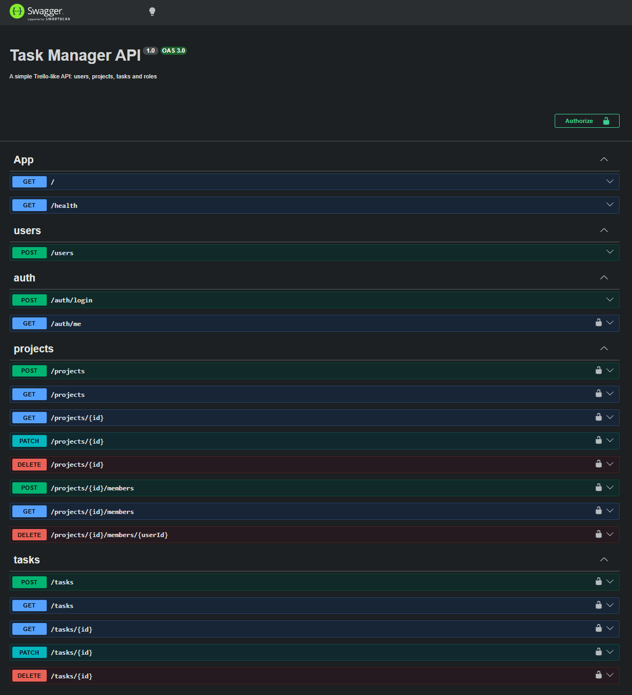
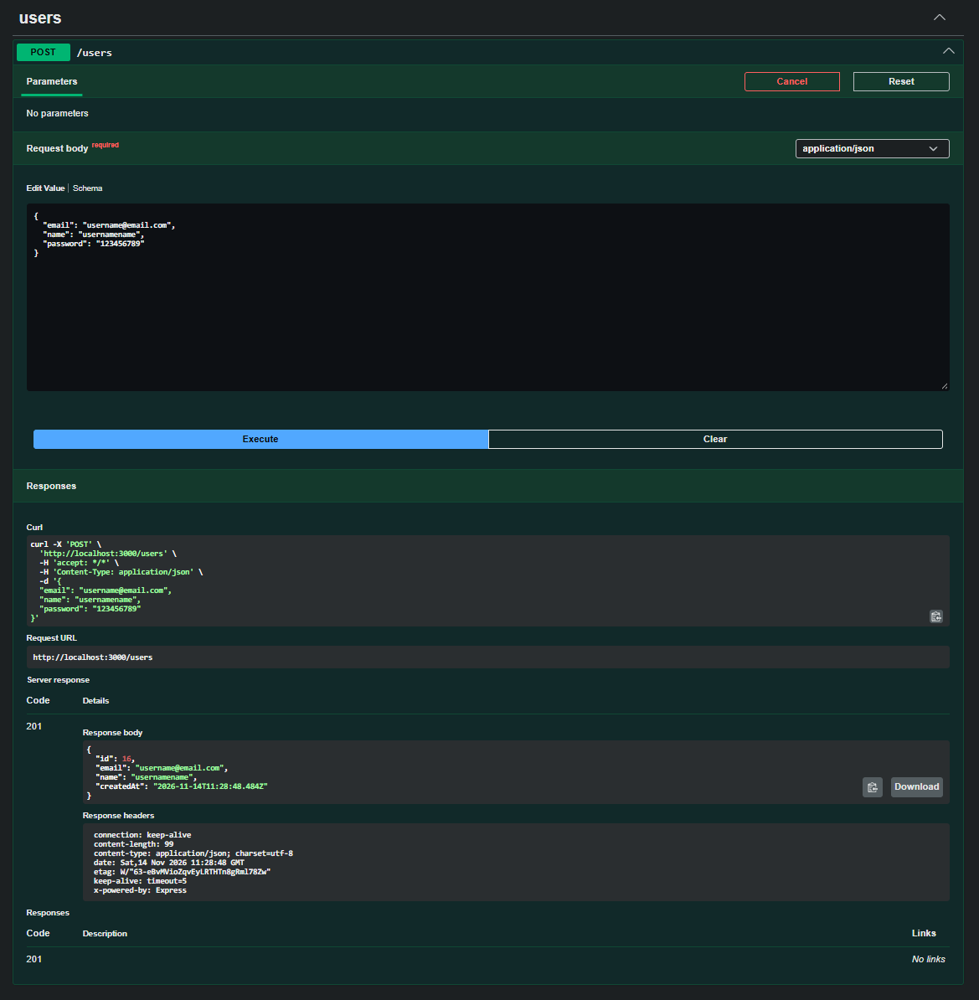

# Task Manager API

[](https://github.com/geovan102/task-manager-api/actions/workflows/ci.yml)

A Trello-like REST API for managing users, projects and tasks, built with NestJS.

## About

Task Manager API is a backend application that provides user authentication, project management, task organization and role-based access control. It demonstrates backend development concepts such as database management, caching, rate limiting, background job processing and automated testing.

## Features

- User registration and login with JWT authentication.
- Password hashing using bcryptjs.
- Projects with members and roles (`OWNER`).
- Tasks with status filtering and pagination.
- Access control for project members and owners.
- Redis caching for read operations (60-second TTL).
- Login rate limiting (5 attempts per minute per IP).
- Background jobs using BullMQ with retries.
- Input validation using class-validator.
- Database indexes for faster queries.

## Tech Stack

- TypeScript
- NestJS
- PostgreSQL
- Prisma
- JWT
- bcryptjs
- Redis
- BullMQ
- class-validator
- Swagger / OpenAPI
- Jest
- Supertest
- Docker
- Docker Compose

## API Documentation

Swagger UI is available at:

**http://localhost:3000/docs**

Log in using `POST /auth/login`, then click **Authorize** in Swagger and paste your JWT token to access protected endpoints.

## Screenshots




## Getting Started

### Requirements

- Node.js 24
- Docker Desktop

### Run with Docker

1. Clone the repository:

   ```bash
   git clone https://github.com/geovan102/task-manager-api.git
   cd task-manager-api
   ```

2. Navigate to the project directory.

3. Copy the example environment file:

   **Windows:**

   ```bash
   copy .env.example .env
   ```

   **macOS / Linux:**

   ```bash
   cp .env.example .env
   ```

4. Set your environment variables in `.env`. Use a strong random value for `JWT_SECRET`.

5. Start the application:

   ```bash
   docker compose up --build
   ```

   Database migrations are applied automatically when the API container starts.

6. Open the API documentation:

   **http://localhost:3000/docs**

### Local Development

Start PostgreSQL and Redis:

```bash
docker compose up -d postgres redis
```

Install dependencies:

```bash
npm install
```

Generate the Prisma Client and apply migrations:

```bash
npx prisma generate
npx prisma migrate deploy
```

Start the development server:

```bash
npm run start:dev
```

The local services use the following ports:

- PostgreSQL: `localhost:5433`
- Redis: `localhost:6379`

## Project Structure

```text
task-manager-api/
│
├── src/
│   ├── auth/        Authentication, JWT guard and rate limiting
│   ├── users/       User registration
│   ├── projects/    Projects, members and invitation jobs
│   ├── tasks/       Tasks, filtering and pagination
│   ├── redis/       Redis connection and caching
│   └── prisma/      Prisma service
│
├── prisma/
│   ├── schema.prisma
│   └── migrations/

## Tests

Run the test suite:

```bash
npm test
```

Tests use mocks for the database and Redis, so external services are not required.

## Known Limitations

- Tests use mocks and do not verify SQL queries against a real database.
- There are no end-to-end tests against a real PostgreSQL database yet.
- Swagger is accessible in every environment.
- Docker Compose uses development credentials and is not configured for production.
- Reverse proxy settings are needed to identify the real client IP for rate limiting.

## Future Improvements

- Add end-to-end tests with a real PostgreSQL database.
- Secure or disable Swagger in production.
- Improve production Docker configuration.
- Add email notifications for project invitations.
- Improve logging and monitoring.

## Author

**Georgios Vanasas**
